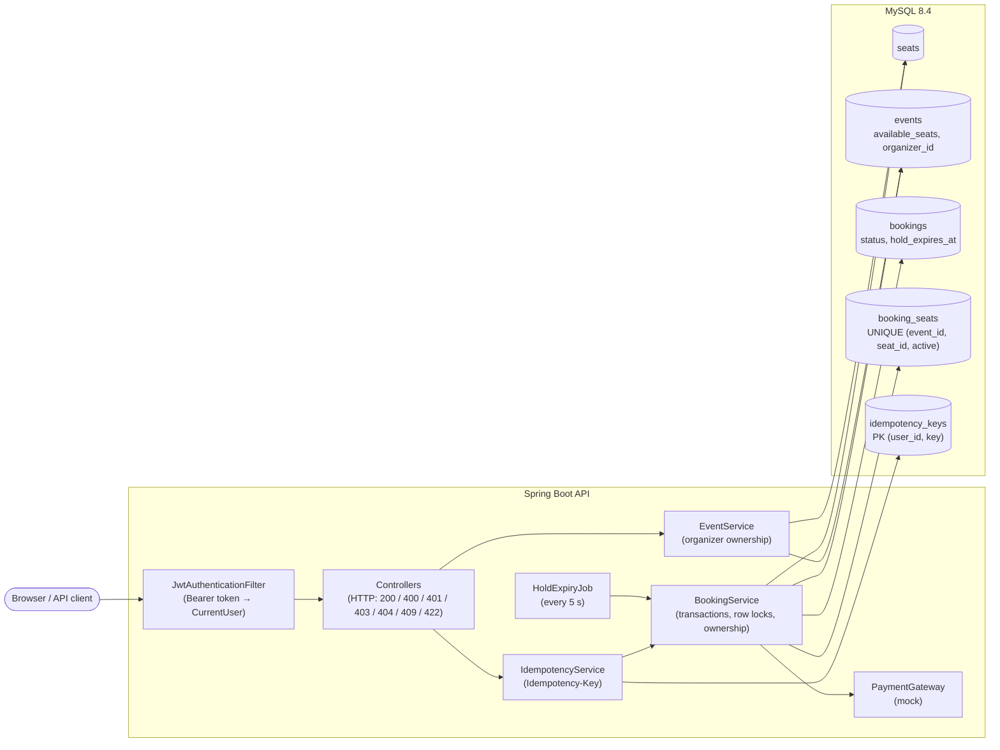
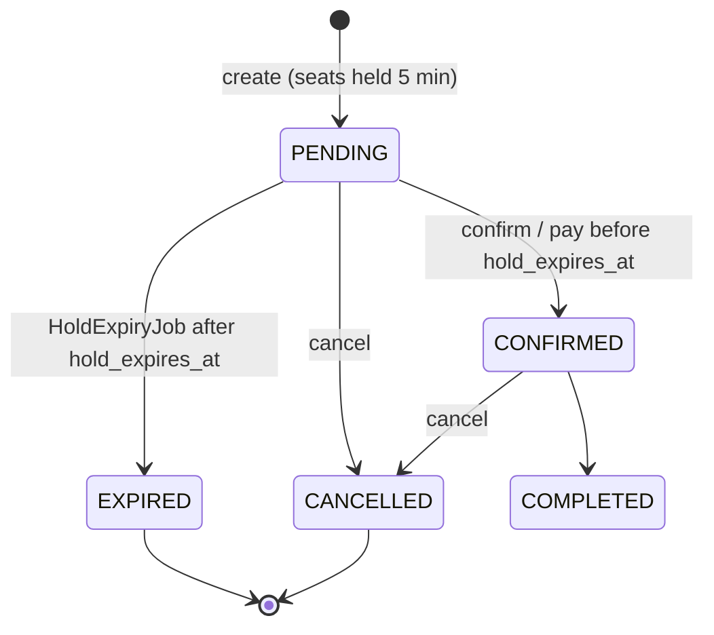

# Event Ticket Booking — Concurrency-Safe Full-Stack Platform

A Spring Boot + MySQL ticket booking app with a **modern luxury Angular 17 UI** where **the same seat can never be sold twice**, even under heavy parallel load. A booking holds its seats for 5 minutes until it's paid for. Unpaid holds expire automatically via background scheduling, and retried requests (double-clicks, client timeouts) don't create duplicate bookings or duplicate charges via idempotency keys. Every call is authenticated with a JWT. Users can touch only their own bookings, and organizers only their own events.

**Stack:**
- **Backend:** Java 21, Spring Boot 3.4, Spring Security, Spring Data JPA (Hibernate 6), MySQL 8.4, Flyway.
- **Frontend:** Angular 17, TypeScript, Modern CSS design system (Dark Slate theme, glassmorphic navigation, 3D curved cinema seating chart, perforated VIP boarding pass ticket wallet, 1-click quick demo logins).
- **DevOps & Testing:** Docker Compose, Testcontainers, k6 (distributed load testing), GitHub Actions CI.

## Architecture



A booking's lifecycle:



`EXPIRED` and `CANCELLED` are final, and moving into either one releases the seats. A released booking
can't be confirmed again, because its seats may already belong to someone else.

## How double-booking is prevented

Two layers, each sufficient on its own for the normal path:

**1. Application: pessimistic row locks.** `BookingService.createBooking` runs in one transaction:

1. `SELECT … FOR UPDATE` on the requested seat rows (`SeatRepository.findForUpdate`). A second
   request for the same seat waits here until the first commits, then sees `available = false` and
   gets **409 Conflict**.
2. `UPDATE events SET available_seats = available_seats - n WHERE id = ? AND available_seats >= n`.
   The check and the decrement happen in one statement, so the counter can't go negative. If it
   updates 0 rows, the event is sold out (409). General-admission events (concerts, sports) have no
   named seats and rely on this step alone.
3. `INSERT` the booking and one `booking_seats` row per seat.

**2. Database: a unique index as a backstop.** `booking_seats` has a row per (booking, seat) claim with
`active = TRUE` while it holds the seat, and `NULL` once released (a `CHECK` rules out `FALSE`).

```sql
CONSTRAINT uk_booking_seats_one_active_claim UNIQUE (event_id, seat_id, active)
```

MySQL has no partial ("`WHERE active`") unique index, but unique indexes treat NULLs as distinct. So a
seat can have any number of released claims but only **one** active claim. If any code path ever
bypassed the lock (a bug, or someone editing a seat's `available` flag in the database), the insert
fails and is turned into the same 409. A test resets the flag with plain SQL to prove this. The API
has no endpoint to change a seat's availability by hand: seats change only through booking, cancel
and expiry.

### Design decisions and tradeoffs

- **Pessimistic over optimistic locking.** Losing requests should be *rejected*, not retried, and the
  lock makes "is it free?" and "take it" happen as one step. It also keeps hold expiry simple, since
  that check is a plain read under the lock. With optimistic locking (a `@Version` column),
  conflicting requests don't wait, but every loser gets an `OptimisticLockException` that has to be
  handled, and that gets harder to reason about once holds and expiry are added.
- **Lock order prevents deadlocks.** Every path that touches both locks the seat rows (sorted by
  `seat_identifier`) before the event row, and booking creation updates the event row *before* its
  inserts. The original code inserted the booking first, which takes a shared lock on the event row
  because of the foreign key, and *then* updated the event. Two requests holding that shared lock each
  waited on the other: **189 of 270** requests in the original-code test run failed with InnoDB
  deadlocks.
- **Only lock what you need.** A unique index on `seats (event_id, seat_identifier)` means the
  `FOR UPDATE` locks just the requested rows. Without it, InnoDB would scan and lock every seat of
  the event.
- **The cost: a hot row per event.** Every booking for an event updates that event's
  `available_seats` row, so bookings for the *same* event commit one at a time even for different
  seats. The load test measures this: about 875 req/s when concurrent requests hit one event, versus
  about 1,640 req/s spread across events. The fix, if needed, is to stop keeping a counter for seated
  events and count the active claims instead.
- **No Open Session in View.** `spring.jpa.open-in-view=false`, so a DB connection is held only for
  each transaction, not the whole HTTP request. With it on, concurrent idempotent retries exhausted
  the 10-connection pool: each request held one connection while waiting for a second.

**Before and after.** The same concurrency tests run against the original code (commit `7d651c3`) and
the fix:

| Test | Original code | Now |
|---|---|---|
| 100 parallel requests for seat A1 | 27 succeeded | 1 succeeded, 99 × 409 |
| 70 users, 70 different seats | 22 succeeded (the rest failed with 500s) | 70 succeeded |
| 100 requests, 10-ticket concert | 24 sold | 10 sold, 90 × 409 |

## How holds expire

- `POST /api/bookings/users/{userId}` creates a **PENDING** booking with
  `holdExpiresAt = now + 5 min` (setting: `booking.hold-duration`). The seats are claimed right away,
  so the hold blocks other users.
- Confirming (`PUT …/confirm-payment` or `POST /api/bookings/payment`) checks the deadline under the
  booking's row lock. A late confirm gets **409**, even if the expiry job hasn't run yet.
- `HoldExpiryJob` runs every 5 s (`booking.hold-sweep-interval`). It finds expired holds with a plain
  read (indexed on `(status, hold_expires_at)`), then calls `expireHold(id)` for each one in its
  own transaction. That method locks the booking and **checks it again** before releasing anything.
- **Confirm racing expiry:** both lock the same booking row, so they run one after the other. If the
  confirm wins, the job sees `CONFIRMED` and does nothing. If the job wins, the confirm sees `EXPIRED`
  and gets a 409. A confirmed booking never loses its seat. This also makes it safe to run the job on
  several app instances at once.
- Time comes from an injected `java.time.Clock`, so expiry logic doesn't depend on the wall clock.
- The API sends `holdExpiresAt` as an exact instant (`2026-10-26T01:11:48.854Z`). The frontend's
  countdown is computed from it, so it's correct in any time zone. The server stays the authority:
  a payment after the deadline is refused no matter what the browser shows.
- **Tradeoff:** an expired seat can stay unavailable for up to one job interval (5 s) before the job
  frees it. Releasing it during the next booking request would remove that gap, but then a booking
  would have to lock and release *another* booking's seats, which breaks the simple lock order.

## How idempotency works

Booking creation and both confirm endpoints accept an optional `Idempotency-Key` header.
`IdempotencyService.execute` does three things **in one transaction**:

1. `INSERT` into `idempotency_keys` with primary key `(user_id, idempotency_key)`, plus a SHA-256
   hash of the endpoint and request body. `user_id` comes from the JWT, so two users can never
   collide on a key.
2. Run the action (create the booking, or charge and confirm).
3. Store the response status and JSON body in that row.

- **Concurrent duplicates** block on the primary key in step 1 until the first transaction commits.
  Their insert then fails as a duplicate, and they return the stored response with
  `Idempotent-Replayed: true`. The key row and the booking commit together or not at all, so a key is
  never "used" without its result.
- **Same key, different body** returns **422**.
- **Expected failures (400/404/409) are stored too**, so a retry gets the same answer even if the
  seat has freed up since. A new key is a new request. Server errors (5xx) aren't stored, so the
  client can retry them.
- **Deadlock retry:** if the first request rolls back, InnoDB may pick one of the waiting duplicates
  as a deadlock victim. That transaction was fully rolled back, so it's retried (up to 3 times).
- **Keys expire** after 24 h (`idempotency.key-ttl`) and are deleted by an hourly job. After that, the
  same key counts as a new request.
- **The frontend makes one key per user action** (`ApiService.idempotencyKeyFor`). For example, "book
  seats A1 and A2 for event 3" gets a key. If that request fails on a network error or a 5xx,
  clicking again reuses the same key, so the retry is safe. The key is dropped once the server gives
  a definite answer. Buttons are disabled while a request is in flight.
- **Payment:** `POST /api/bookings/payment` charges through `PaymentGateway` (a mock here) while
  holding the booking lock, and only if the booking is still `PENDING`. A booking is charged at most
  once, even with no key. **Tradeoff:** the charge happens inside the DB transaction. With a real
  provider, that holds the lock during a network call, and a commit failure after a successful charge
  would need reconciliation. In production you'd pass the booking ID as the provider's own
  idempotency key and confirm via a webhook.

## Authentication and authorization

**Token flow:**

1. `POST /api/auth/login` with `{email, password}`. The password is checked against its BCrypt hash.
   The response is `{token, user}`, and a wrong email or password gives 401 with the same message
   for both.
2. The token is a JWT signed with HMAC-SHA256. Claims: `sub` (user ID), `email`, `role`, `iat`, and
   `exp` (24 h).
3. **The signing secret** comes only from the `JWT_SECRET` environment variable. There's no default
   in the repo, and the app refuses to start without it or if it's shorter than 32 bytes.
4. The client sends `Authorization: Bearer <token>` on every call.
5. `JwtAuthenticationFilter` verifies the signature and expiry, then puts a `CurrentUser(id, email,
   role)` in the security context. Controllers get it with `@AuthenticationPrincipal`. **The caller
   is always the user in the token, never an ID from the URL or body.**
6. A missing, forged or expired token leaves the request anonymous. Public endpoints still work,
   and protected ones return **401**. On a 401 the frontend logs out and goes to the login page.

**Roles** (enforced by URL in `SecurityConfig`):

| Who | Can |
|---|---|
| Anyone | Log in, register (as USER or ORGANIZER only), browse events and seat maps |
| USER (any logged-in user) | Create, view, confirm, pay for and cancel **their own** bookings |
| ORGANIZER | Create events (owned by them), edit, delete, reprice and see analytics for **their own** events |
| ADMIN | User management (`/api/users/**`), all bookings, any event's analytics and bookings, manual status changes |

**Ownership** (enforced in the service layer, because it depends on the data, not the URL):

| Situation | Response | Why |
|---|---|---|
| Reading, paying or cancelling someone else's booking | **404** | Booking IDs are sequential; a 403 would confirm that booking N exists |
| A user ID in the URL that isn't yours (`/api/bookings/users/{id}`) | **403** | You named yourself wrongly; there's nothing to hide |
| Editing or deleting another organizer's event | **403** | Events are public anyway |
| Wrong role for the URL (e.g. a USER calling `POST /api/events`) | **403** | |

**Tradeoffs:**
- **Stateless tokens:** the server keeps no session, so it scales out easily. The cost is that a
  role change or account deletion only takes effect when the token expires; there's no revocation
  list or refresh token.
- **Token in `localStorage`:** this is simple, but any XSS bug could read it. An `HttpOnly` cookie
  would be safer, but then the API would need CSRF protection.
- **Passwords:** these were already BCrypt-hashed in the original code, so existing accounts didn't
  change.
- **Registration roles:** the original registration let anyone choose ADMIN. It now accepts only
  USER or ORGANIZER; admins come from seed data.

## API

| Method & path | Who | Notes |
|---|---|---|
| `POST /api/auth/login` | anyone | → `{token, user}` |
| `POST /api/users/register` | anyone | role `USER` or `ORGANIZER` |
| `GET /api/events`, `/api/events/{id}`, `/api/events/{id}/seats` | anyone | seat map with real availability |
| `POST /api/events` | ORGANIZER | owner = the caller; seated events get exactly `totalSeats` seats (max 260, rows of 10) |
| `PUT / DELETE /api/events/{id}` | owning ORGANIZER | delete → 409 if the event has bookings |
| `POST /api/bookings/users/{userId}` | that user | hold seats; body `{eventId, seatNumbers?, numberOfTickets}`; 409 if taken or sold out |
| `GET /api/bookings/{id}` | owner or ADMIN | |
| `PUT /api/bookings/{id}/confirm-payment?paymentId=…` | owner | 409 if not PENDING or hold expired |
| `POST /api/bookings/payment` | owner | pay through the mock gateway and confirm |
| `DELETE /api/bookings/{id}` | owner | cancel and release seats; safe to repeat |
| `GET /api/bookings`, `PUT /api/bookings/{id}/status`, `/api/users/**` | ADMIN | |

All three booking write endpoints accept `Idempotency-Key`. Errors use one JSON shape:
`{"status": 409, "message": "Seat(s) already taken: [A1]", "timestamp": "…"}`.

**What changed from the original API:**
- **Login moved:** it's now `POST /api/auth/login` (was `/api/users/login`) and returns a real JWT
  instead of a Base64 string.
- **Tokens are required:** every non-public endpoint needs a token, and URL user IDs must match it.
- **Seat endpoints removed:** `PUT /api/events/{id}/seats/{seatId}`, `POST /api/events/{id}/initialize-seats`
  and the unreachable `/api/seats/**`. Use `GET /api/events/{id}/seats`.
- **New response fields:** `EventDTO` has `organizerId`, and `BookingDTO.holdExpiresAt` is an
  ISO-8601 instant.
- **Seat counts are exact:** seated events honor `totalSeats` instead of always creating 70 seats.
  It can't be changed after creation (409), because that could delete booked seats.

## Running the Application

### Start, Open, and Stop (Docker Compose)

The entire platform (MySQL 8.4 database, Spring Boot API, and Angular frontend) runs with Docker Compose.

#### 1. Setup Environment
```bash
cp .env.example .env
```
Ensure `.env` contains a `JWT_SECRET` of at least 32 characters (e.g. generated via `openssl rand -base64 48`).

#### 2. Start the Application
Run in the background (detached):
```bash
docker compose up -d --build
```
*(Or omit `-d` if you wish to see all service logs directly in your terminal).*

#### 3. Open in Browser
- **Frontend App:** [http://localhost:4200](http://localhost:4200)
- **Backend API:** [http://localhost:8080](http://localhost:8080)
- **MySQL Database:** `localhost:3307` (database: `ticketing`, user: `ticketing`, password: `ticketing`)

#### 4. Stop the Application
To stop all running services:
```bash
docker compose down
```
To stop and reset all database state (wipes volumes and re-seeds fresh data on next start):
```bash
docker compose down -v
```

#### 5. View Service Logs
```bash
docker compose logs -f
```

---

### Demo Accounts & 1-Click Login

The database is pre-seeded with sample events and role-based test accounts. The login screen features **1-Click Quick Demo Login** chips for instant access:

| Role | Email | Password | Pre-configured Access |
|---|---|---|---|
| **Admin** | `admin@demo.test` | `demo1234` | Full access: platform metrics, booking audit, user management |
| **Organizer** | `organizer@demo.test` | `demo1234` | Event owner: create events, manage seating, view sales & analytics |
| **Attendee (User)** | `alice@demo.test` | `demo1234` | Customer: view shows, book seats, VIP boarding pass wallet |
| **Attendee (User)** | `bob@demo.test` | `demo1234` | Customer: used for testing real-time concurrent booking contention |

> [!NOTE]
> Demo seeding runs because `docker-compose.yml` sets `APP_SEED_DEMO_DATA=true`. For production deployments, remove or disable this variable.

---

### Demo Walkthrough: Real-Time Seat Contention

To test concurrency protection and the 5-minute hold timer in real time:

1. Open [http://localhost:4200](http://localhost:4200) in a standard browser tab and click the **Alice (User)** quick-login chip.
2. Open [http://localhost:4200](http://localhost:4200) in an **Incognito / Private tab** and click the **Bob (User)** quick-login chip.
3. In both tabs, select *Midnight Premiere*, choose a showtime, and select seat **A1**.
4. Click **Confirm Booking** in Bob's tab: Bob secures a 5-minute hold, and his **My Bookings** shows the live hold countdown.
5. Immediately click **Confirm Booking** in Alice's tab: Alice receives a conflict alert (*"That seat was just taken, please pick another."*), and seat **A1** turns red/unavailable in real time.
6. *(Optional)* Let Bob's hold expire (or set `BOOKING_HOLD_DURATION=PT30S` in `.env`): the background scheduler releases the hold, Bob's ticket transitions to *Hold Expired*, and **A1** becomes available again.

**Tests** (needs JDK 21 and a running Docker daemon; the tests start their own MySQL with
Testcontainers):

```bash
cd backend && ./mvnw verify
```

There are 29 integration tests against real MySQL over real HTTP. Every request is authenticated
through the real login endpoint. They cover:
- parallel bookings for one seat, for many seats, and with one idempotency key
- hold expiry, by moving an injected clock forward
- the security rules

CI runs the same command on every push (`.github/workflows/ci.yml`).

**Load test** (k6 runs from its Docker image, so there's nothing to install):

```bash
docker compose up -d --build mysql app
loadtest/run.sh no_contention   # or: hot_event, contention
```

## Load test results

`POST /api/bookings/users/{userId}`, measured with k6 1.3.0 and JWT authentication enabled. Setup
registers and logs in 100 users, and every booking request carries one of their bearer tokens. Each scenario ran 3
times, each time on a fresh database. Values are listed as **run 1 / run 2 / run 3**. Throughput
covers only the booking phase (setup excluded). Raw k6 summaries are in
[`loadtest/results/`](loadtest/results/).

| Scenario | Requests | Throughput (req/s) | p95 (ms) | p99 (ms) | Unexpected errors |
|---|---|---|---|---|---|
| `no_contention`: 50 VUs, every request a different seat, spread over 100 events | 7,000 | 1620 / 1637 / 1655 | 65.8 / 62.9 / 65.0 | 95.0 / 104.9 / 92.6 | 0 / 0 / 0 |
| `hot_event`: 50 VUs, every request a different seat, concurrent requests on the same event | 7,000 | 860 / 866 / 904 | 102.2 / 92.1 / 93.7 | 137.6 / 122.6 / 122.4 | 0 / 0 / 0 |
| `contention`: 100 VUs, 5,000 requests for 350 seats | 5,000 | 2423 / 2450 / 2354 | 130.2 / 121.7 / 125.4 | 204.1 / 199.3 / 206.8 | 0 / 0 / 0 |

- **Error rate was 0% in every run.** Every response was a 200 or an expected 409.
- **Contention outcome:** every contention run produced exactly **350 successes and 4,650 × 409**.
  Afterwards MySQL showed 350 active claims and 0 seats with more than one active claim.
- **Why contention looks faster:** most of its requests are quick 409s that write nothing. Its p95 and
  p99 are higher because the winners wait on seat and event row locks.
- **Hot-row cost:** `no_contention` vs `hot_event` is the event-row cost described above. That's
  roughly half the throughput when every concurrent request targets the same event.
- **Cost of authentication:** before JWT auth was added (commit `b1ebc45`, same machine and
  scenarios), throughput was about 1,780 / 950 / 2,910 req/s. Checking the token's signature and
  running the security filter chain costs about 8% on the first two scenarios. It costs about 17%
  on `contention`, where most requests are cheap 409s, so the token check is a bigger share of each
  one.

**Environment:** Apple M5 (10 cores, 16 GB), macOS 27.0.1, Docker Desktop 29.9.2 (VM: 10 CPUs, 7.7 GB).
The app, MySQL and k6 all ran on that one machine, with the default Hikari pool of 10 connections and
no tuning. These numbers show relative behavior, not production capacity.

## Known limitations

- **Show times share seats:** the time picker is only in the frontend. Seats belong to the event, so
  booking A1 at 7:30 PM also takes it at 10:00 AM.
- **No token revocation or refresh:** a token stays valid until it expires (24 h), even if the
  user's role changes. The token is kept in `localStorage`.
- **Mock payments only:** there's no real payment provider, no email notifications and no analytics
  beyond the basic sales report.
- **Dev frontend:** compose runs the frontend with Angular's dev server (`ng serve`), not an
  optimized production build.

## Author

Built by Charan Kappala.
